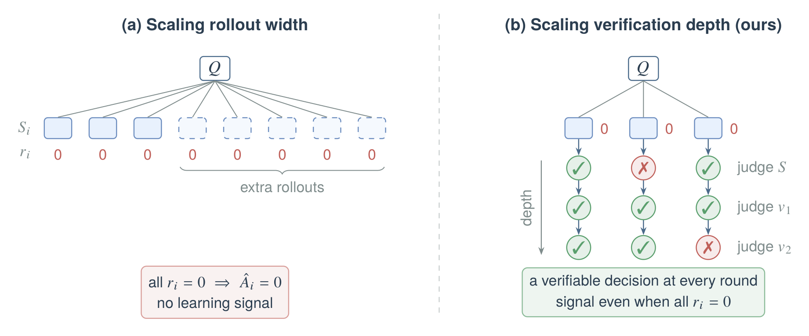
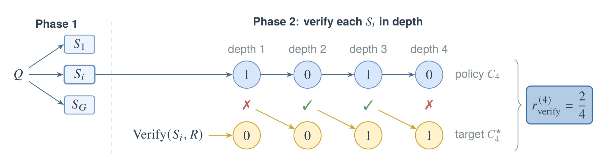

<div align="center">

# Scaling Verification Depth for Stronger Reasoning

**Don't just sample more solutions. Learn more from each one.**

A two-phase RLVR recipe in which the policy verifies every solution it writes,<br>
then verifies its own verdicts, round after round.

<p>


</p>

<p>
<a href="#highlights">Highlights</a> &nbsp;•&nbsp;
<a href="#motivation">Motivation</a> &nbsp;•&nbsp;
<a href="#method">Method</a> &nbsp;•&nbsp;
<a href="#citation">Citation</a>
</p>



<sub><b>Two ways to spend extra training compute on a hard question.</b> (a) Scaling rollout width samples more solutions,
but if all of them fail, every reward is 0 and the group-relative advantages vanish. (b) Scaling verification depth
verifies each existing solution over several rounds, each judging the previous verdict.</sub>

</div>

<br>

<a id="highlights"></a>

## ✨ Highlights

- 🔁 **A new scaling axis.** Extra compute goes into *verification depth*, a chain of rounds that reassess earlier
  judgments, instead of ever wider rollouts.
- 🎯 **Signal where GRPO has none.** Every round ends in a verifiable decision, so a question whose solutions all fail
  still produces learning signal.
- 🪞 **Self-correction by design.** Later rounds judge earlier verdicts. The model learns to catch its own misjudgments
  and to keep the assessments that were right.
- 🧩 **One policy, one update.** Solutions and verification rounds come from the same policy snapshot and are optimized
  together: $`\mathcal J = \mathcal J_{\mathrm{GRPO}} + \mathcal J_{\mathrm{verify}}`$.

<a id="motivation"></a>

## 💡 Motivation

Recent work on reinforcement learning with verifiable rewards (RLVR) improves training efficiency by scaling the number
of generated solutions. [VIP](https://proceedings.iclr.cc/paper_files/paper/2026/hash/dc62cd4ec77f3bbec8e6245d0bd91d08-Abstract-Conference.html)
and [DARS](https://proceedings.mlr.press/v306/yang26s.html) adaptively allocate rollout budgets across questions to
explore difficult problems better. Scaling rollout width has an inherent limit, though: more solutions do not
necessarily mean more useful signal. On a hard question, extra rollouts can all fail, the rewards stay uniformly zero,
and the group-relative advantages vanish. These approaches also spend the extra computation on exploring new
solutions and leave unused the signal hidden in attempts that were already generated.

> [!NOTE]
> **The question we ask:** rather than continuously generating more solutions, can we improve reasoning by learning
> more deeply from each existing solution?

We propose an alternative scaling direction, **verification depth**. The model goes through a sequence of verification
rounds, each reassessing its previous judgment. Every round produces a verifiable decision, so the model gets learning
signal even when the original solution is wrong. The recursion teaches the model to identify incorrect solutions,
to recognize mistakes in its own judgments, and to preserve correct assessments. We hypothesize that, under a
comparable training budget, this improves reasoning more efficiently than simply widening the rollouts.

<a id="method"></a>

## 🧠 Method

### Two rollout phases

Each training step has two rollout phases. **Phase 1** is the standard GRPO rollout: the policy samples $`G`$
solutions to a question. **Phase 2** scales verification in depth: the policy generates one verification chain of
$`M`$ sequential rounds for each solution, where $`M`$ is the *verification depth*. Both phases sample from
$`\pi_{\theta_{\mathrm{old}}}`$ and are optimized in the same update. Every verification round is a separate
prompt-response example with its own correctness reward.

<p align="center">
  
</p>

<p align="center"><sub>
Phase 1 samples <i>G</i> solutions to <i>Q</i>. Phase 2 generates one verification chain of depth <i>M</i> for each
<i>S<sub>i</sub></i> (here <i>M</i> = 4, and <i>S<sub>i</sub></i> is incorrect). Blue: policy verdicts;
<i>v</i><sub>1</sub> judges <i>S<sub>i</sub></i>, and each <i>v<sub>d</sub></i> judges <i>v</i><sub><i>d</i>−1</sub>.
Yellow: target verdicts. Each match (✓/✗) determines the next target and supplies the current round's reward.
</sub></p>

### Phase 1 · Solution generation

For each question $`Q`$ with reference answer $`R`$, the policy samples $`\{S_i\}_{i=1}^{G} \sim \pi_{\theta_{\mathrm{old}}}(\cdot \mid Q)`$.
A rule-based verifier assigns each solution a binary outcome reward $`r_i = \mathrm{Verify}(S_i, R) \in \{0, 1\}`$,
and the solutions are trained with GRPO's group-normalized advantage:

```math
\hat A_{i,t}=\frac{r_i-\mathrm{mean}\big(\{r_j\}_{j=1}^{G}\big)}{\mathrm{std}\big(\{r_j\}_{j=1}^{G}\big)} .
```

<details>
<summary><b>The GRPO objective</b></summary>

```math
\mathcal J_{\mathrm{GRPO}}(\theta)=\mathbb E\Bigg[\frac{1}{G}\sum_{i=1}^{G}\frac{1}{|o_i|}\sum_{t=1}^{|o_i|}\Big(\min\big(\rho_{i,t}(\theta)\hat A_{i,t},\ \mathrm{clip}\big(\rho_{i,t}(\theta),1-\varepsilon,1+\varepsilon\big)\hat A_{i,t}\big)-\beta\,\mathbb D_{\mathrm{KL}}\big[\pi_\theta\,\|\,\pi_{\mathrm{ref}}\big]\Big)\Bigg],
\qquad
\rho_{i,t}(\theta)=\frac{\pi_\theta(o_{i,t}\mid Q,o_{i,<t})}{\pi_{\theta_{\mathrm{old}}}(o_{i,t}\mid Q,o_{i,<t})}
```

with $`o_i = S_i`$, clipping range $`\varepsilon`$, and KL weight $`\beta`$ toward a frozen reference policy $`\pi_{\mathrm{ref}}`$.

</details>

### Phase 2 · Verification chain

For each solution $`S`$, the policy generates one chain of $`M`$ rounds. Round 1 sees the question and the solution;
every later round additionally sees **only the previous round's final answer**:

```math
x_d=\begin{cases}(Q,\,S), & d=1,\\[2pt](Q,\,S,\,A_{d-1}), & d=2,\ldots,M,\end{cases}
\qquad
V_d\sim\pi_{\theta_{\mathrm{old}}}(\cdot\mid x_d),
\qquad
\bar A_d=\mathrm{ExtractAnswer}(V_d).
```

$`\bar A_d`$ is the final answer after the closing `</think>` tag and contains a binary verdict $`v_d`$. The reasoning
inside `<think>` is never passed to later rounds.

| Round | Sees | Verdict $`v_d = 1`$ claims |
|:---:|:---|:---|
| $`d = 1`$ | question $`Q`$, solution $`S`$ | the solution $`S`$ is correct |
| $`d \ge 2`$ | $`Q`$, $`S`$, previous final answer $`A_{d-1}`$ | the previous verdict $`v_{d-1}`$ is correct |

To keep each forwarded answer self-contained, a **running conclusion** about whether $`S`$ is correct is attached to it:

```math
c_1=v_1,
\qquad
c_d=\begin{cases}c_{d-1}, & v_d=1,\\ 1-c_{d-1}, & v_d=0,\end{cases}
\qquad
A_d=(\bar A_d,\ c_d).
```

The conclusion is computed deterministically from the sampled verdicts, without the reference answer. It summarizes the
verdict history without carrying any earlier reasoning trace. The policy chain is $`C_M=(v_1,\ldots,v_M)`$.

### Target chain and round reward

The **target chain** $`C_M^\star=(v_1^\star,\ldots,v_M^\star)`$ holds the correct verdict at every depth. It starts
from the phase-1 outcome, and each later target records whether the policy was right one depth earlier:

```math
v_1^\star=\mathrm{Verify}(S,R),
\qquad
v_d^\star=\mathbf{1}\big[v_{d-1}=v_{d-1}^\star\big],
\quad d=2,\ldots,M.
```

The target chain is built after the policy chain is generated and is never shown to the policy. Each round receives
its own binary correctness reward. Equivalently, a verdict is correct exactly when its running conclusion agrees with
the solution's outcome:

```math
r_d^{\mathrm{verify}}=\mathbf{1}\big[v_d=v_d^\star\big]=\mathbf{1}\big[c_d=\mathrm{Verify}(S,R)\big]\in\{0,1\}.
```

<details open>
<summary><b>Worked example</b>: the chain from the figure above (<i>M</i> = 4, incorrect solution, Verify(<i>S</i>, <i>R</i>) = 0)</summary>
<br>

| depth $`d`$ | 1 | 2 | 3 | 4 |
|:---|:---:|:---:|:---:|:---:|
| policy verdict $`v_d`$ | 1 | 0 | 1 | 0 |
| running conclusion $`c_d`$ | 1 | 0 | 0 | 1 |
| target verdict $`v_d^\star`$ | 0 | 0 | 1 | 1 |
| round reward $`r_d^{\mathrm{verify}}`$ | ✗ 0 | ✓ 1 | ✓ 1 | ✗ 0 |
| feedback $`\hat A_d^{\mathrm{verify}} = r_d - \tfrac12`$ | −½ | +½ | +½ | −½ |

Round 1 wrongly accepts the solution. Round 2 correctly rejects that verdict. Round 3 correctly keeps round 2's
verdict. Round 4 wrongly overturns it. The summary score
$`r^{(M)}_{\mathrm{verify}} = \frac{1}{M} \sum_d r_d^{\mathrm{verify}} = \frac{2}{4}`$ is kept for monitoring only: training uses
the individual round rewards.

</details>

### Training objective

Each pair $`(x_{i,d}, V_{i,d})`$ is a separate training example whose sampled context is held fixed during the update.
Its feedback uses a **fixed baseline** of ½, rewarding correct rounds and penalizing incorrect ones without comparing
different branches or depths:

```math
\hat A^{\mathrm{verify}}_{i,d}=r^{\mathrm{verify}}_{i,d}-\tfrac12=\begin{cases}+\tfrac12, & v_{i,d}=v^\star_{i,d},\\ -\tfrac12, & v_{i,d}\neq v^\star_{i,d}.\end{cases}
```

Phase 2 is then trained with the round-level clipped policy-gradient objective

```math
\mathcal J_{\mathrm{verify}}(\theta)=\mathbb E\Bigg[\frac{1}{GM}\sum_{i=1}^{G}\sum_{d=1}^{M}\frac{1}{|V_{i,d}|}\sum_{t=1}^{|V_{i,d}|}\Big(\min\big(\rho^{\mathrm{verify}}_{i,d,t}(\theta)\hat A^{\mathrm{verify}}_{i,d},\ \mathrm{clip}\big(\rho^{\mathrm{verify}}_{i,d,t}(\theta),1-\varepsilon,1+\varepsilon\big)\hat A^{\mathrm{verify}}_{i,d}\big)-\beta\,\mathbb D_{\mathrm{KL}}\big[\pi_\theta\,\|\,\pi_{\mathrm{ref}}\big]\Big)\Bigg],
```

where $`\rho^{\mathrm{verify}}_{i,d,t}(\theta)=\pi_\theta(V_{i,d,t}\mid x_{i,d},V_{i,d,<t})\,/\,\pi_{\theta_{\mathrm{old}}}(V_{i,d,t}\mid x_{i,d},V_{i,d,<t})`$,
and the policy maximizes the combined objective

```math
\mathcal J(\theta)=\mathcal J_{\mathrm{GRPO}}(\theta)+\mathcal J_{\mathrm{verify}}(\theta).
```

**Design choices**

- 🧱 **Round-level credit.** Each round is trained for its own verdict accuracy. Rewards of later rounds are never
  credited to earlier responses, and the chain is never concatenated into a single training response.
- 🎭 **What is trained.** A round's feedback is shared by all of its generated tokens, reasoning and final answer.
  The question, the solution, the previous final answer and the round instructions are masked. The deterministic
  conclusion field is not generated by the policy and gets no loss.
- ⚖️ **What is rewarded.** Rewards score binary verdicts, not the validity of the reasoning that leads to them.
- 📈 **Cost.** Phase 2 adds $`G \times M`$ verification rounds, and as many training examples, per question.

<details>
<summary><b>What a verification round sees</b> (prompt templates)</summary>
<br>

**Round 1**

```text
Question:
{question Q}

Proposed solution:
{solution S}

Check whether the proposed solution above is correct: verify its steps and whether its final answer correctly
answers the question. Do not solve the problem from scratch. Write a short analysis, then end with exactly one line:
Verdict: CORRECT
or
Verdict: INCORRECT
```

**Round d ≥ 2**

```text
Question:
{question Q}

Proposed solution:
{solution S}

Previous verification round:
{final answer of round d-1, the text after </think>}

Running conclusion: the proposed solution is {CORRECT | INCORRECT}.

The previous verification round above may contain mistakes. Check whether its verdict is right, i.e. whether the
running conclusion about the proposed solution is correct. Write a short analysis, then end with exactly one line:
Verdict: CORRECT (the previous verdict is right)
or
Verdict: INCORRECT (the previous verdict is wrong)
```

</details>

## 🗂️ Repository layout

```text
allocate_repair/
├── verify_depth.py          chain logic: running conclusions, target chain, round rewards, prompts
├── verify_trainer_v2.py     two-phase trainer: solutions, verification chains, round-level examples
├── agent_loop.py            vLLM agent loop with per-phase sampling settings
├── losses.py                clipped objective per phase: J_GRPO + J_verify in one update
├── reward_fn.py             rule-based verifier with binary rewards
└── config/                  Hydra config (extends verl's PPO trainer)
scripts/
├── setup_env.sh             conda environment
├── download_data.sh         dataset download and preparation
├── train_verify_depth_v2_qwen3_dapo.sh    training launcher
└── plot_run.py              progress figures
tests/test_verify_depth_v2.py             CPU tests of the method
third_party/verl/            verl v0.9.1 (submodule)
```

The method is covered by CPU tests: the running-conclusion recursion and its equivalence to the round reward, the
worked example above, the prompt contents of each round, round rewards and advantages, a scripted end-to-end rollout,
and the round-level token-mean loss.

```bash
python -m pytest -q tests/test_verify_depth_v2.py
```

<a id="citation"></a>

## 📝 Citation

```bibtex
@misc{le2026verificationdepth,
  title        = {Scaling Verification Depth for Stronger Reasoning},
  author       = {Le, Tue},
  year         = {2026},
  month        = {oct},
  howpublished = {\url{https://github.com/tue09/allocate-repair-RLVR}}
}
```

## 🙏 Acknowledgements

Built on [verl](https://github.com/verl-project/verl) and [vLLM](https://github.com/vllm-project/vllm). Trained on
[DAPO-Math-17k](https://huggingface.co/datasets/BytedTsinghua-SIA/DAPO-Math-17k) with
[Qwen3](https://huggingface.co/Qwen/Qwen3-1.7B).
